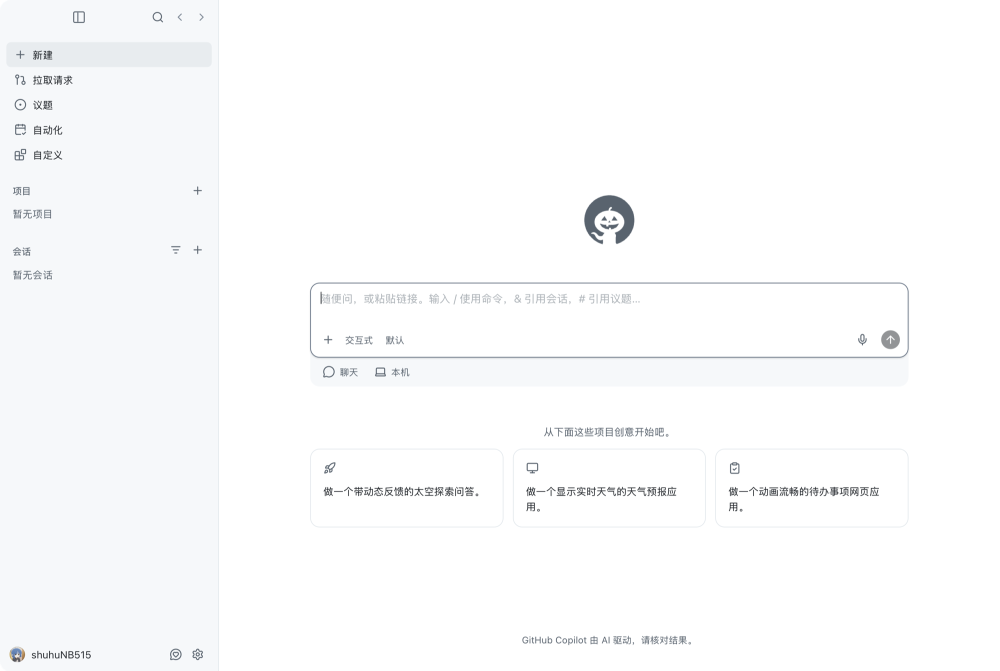
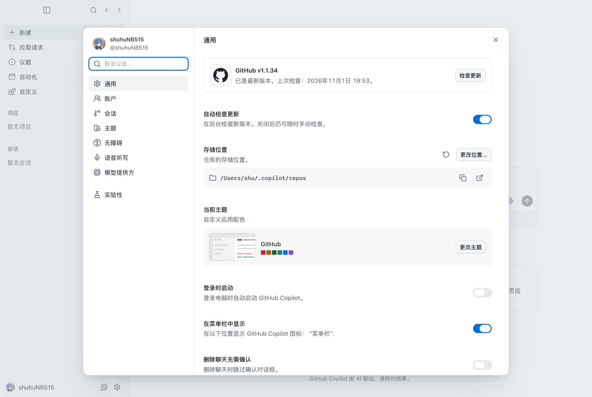

# githubcopilot-desktop-zh-mac

[](https://github.com/shuhuNB515/githubcopilot-desktop-zh-mac/actions/workflows/build.yml)

把 **GitHub Copilot 桌面端（macOS）** 的界面变成中文。

> ⚠️ 仅支持 **macOS + Apple Silicon（arm64）**。本项目只做界面本地化，不修改官方安装包，也不分发 GitHub 的二进制。



<p align="center"><sub>实际运行截图：主界面（汉化后）</sub></p>

---

## 特性

- 主界面、设置页、侧边栏、输入框、原生菜单栏全中文
- **不改动 `/Applications` 里的官方应用**：只对一份应用副本注入，随时可弃用
- 词条 + 规则两层翻译：`新建会话 ⌘N，新建聊天 ⌘⇧N。`、`切换侧边栏 (⌘B)`、日期、百分比等动态文本自动处理
- 词典可自行扩充（纯文本 TSV），改完热更新即可看到效果
- 应用自动更新把签名还原后，启动器会自动重新签名再启动

## 界面预览

| 设置 · 通用 | 主界面 |
| --- | --- |
|  |  |

## 原理

这个应用是 **Tauri** 应用：界面是 WKWebView 里的 Web 前端，前端资源以 brotli 压缩后嵌在 500MB+ 的 Mach-O 可执行文件里。
直接改包体风险高、一更新就失效，所以采用**运行时注入**：

```
GitHub Copilot 中文版.app (启动器)
        │  设置 COPILOT_CN_DIR / DYLD_INSERT_LIBRARIES
        ▼
~/Applications/GitHub Copilot.app (ad-hoc 重签名的副本)
        │  dyld 加载 CopilotCN.dylib
        ▼
CopilotCN.dylib
        ├─ hook -[WKWebView initWithFrame:configuration:]
        │     └─ 注入 WKUserScript：dict.json + translator.js
        ├─ 遍历 NSApp.mainMenu，替换菜单标题（menu.json）
        └─ 文件命令通道（调试/抓取文案用）
        ▼
WKWebView 页面
        └─ translator.js：遍历 DOM 文本节点与 aria-label/title/placeholder
           ├─ 精确词条匹配（471 条）
           ├─ 规则：快捷键组合、日期、百分比、"X, Command + K"…
           └─ MutationObserver 跟随 React 重渲染
```

因为要注入第三方动态库，副本需要 `com.apple.security.cs.disable-library-validation` 权限，
所以安装脚本会用 ad-hoc 签名给副本重签（约 1–2 分钟）。官方应用不受影响。

## 环境要求

| 项目 | 要求 |
| --- | --- |
| 系统 | macOS 12 或更高（在 macOS 27 + Copilot 1.1.34 上验证） |
| 芯片 | **Apple Silicon（arm64）**；Intel 不支持（官方 app 本体即 arm64） |
| 应用 | 已安装 `/Applications/GitHub Copilot.app` |
| 编译 | 一般不需要；仅当从源码构建 dylib 时需要 Xcode Command Line Tools |

## 安装

```bash
git clone https://github.com/shuhuNB515/githubcopilot-desktop-zh-mac.git
cd githubcopilot-desktop-zh-mac
./install.sh
```

安装脚本会：

1. 把运行时（词典、翻译脚本）装到 `~/Library/Application Support/CopilotCN/`
2. 把官方应用 **克隆** 一份到 `~/Applications/GitHub Copilot.app`（APFS 写时复制，几乎不额外占空间）
3. 给副本做 ad-hoc 重签名（含 `disable-library-validation`）
4. 在 `~/Applications` 生成启动器 **`GitHub Copilot 中文版.app`**

## 使用

双击 **`~/Applications/GitHub Copilot 中文版.app`**，或：

```bash
open "$HOME/Applications/GitHub Copilot 中文版.app"
```

登录状态、会话、设置全部沿用原来的（同一个 bundle id）。**请用启动器打开**；Dock 上原来的英文图标仍是原版。

## 卸载

```bash
./uninstall.sh
```

删除启动器、`~/Applications` 下的副本和运行时数据，`/Applications` 中的官方应用不受影响。

## 应用更新之后

Copilot 自动更新会覆盖副本并恢复官方签名，注入随之失效（表现为**双击没反应 / 图标一闪就退**）。

原因：注入库需要 `com.apple.security.cs.disable-library-validation` 权限，官方签名没有这个权限，
dyld 会直接 `SIGKILL` 掉带 `DYLD_INSERT_LIBRARIES` 的进程。

处理：**用「GitHub Copilot 中文版」启动器重新打开即可**。启动器检测到签名被还原会自动重签
（右下角会弹出通知，首次约 1–2 分钟），然后再启动。也可以在终端手动执行：

```bash
"$HOME/Library/Application Support/CopilotCN/sign.sh"   # 只重签名
./install.sh                                            # 或完整重装
```

## 自定义词典

- 词条格式：`英文<TAB>中文`，位于 [`src/dict-user.tsv`](src/dict-user.tsv)（优先级最高）
- 重建词典并安装：

```bash
./build.sh --dict     # 合并 src/dict-*.tsv → runtime/dict.json
./install.sh          # 同步到 ~/Library/Application Support/CopilotCN
```

- 运行中想立刻看到效果（无需重启应用）：

```bash
export COPILOT_CN_DIR="$HOME/Library/Application Support/CopilotCN"
./tools/reload.sh
```

- 快捷键、`Edit shortcut for X`、`X, Command + K`、日期、百分比等由 [`runtime/translator.js`](runtime/translator.js) 里的规则生成，不需要逐个加词条。

## 开发工具

| 脚本 | 用途 |
| --- | --- |
| `tools/cnop.sh '{"op":"ping"}' ` | 向页面发送指令（click / dump / text / input 等） |
| `tools/ev.sh file.js` | 在页面里执行任意 JS（原生 evaluateJavaScript，绕过 CSP） |
| `tools/cnative.sh '{"op":"menudump"}'` | 导出原生菜单树 / 触发菜单项 |
| `tools/reload.sh` | 热更新词典与翻译器 |
| `tools/build_dict.py` | 合并 TSV 生成 dict.json |

使用前设置 `COPILOT_CN_DIR` 指向正在运行的实例数据目录；日志在 `copilot-cn.log`。

## 目录结构

```
.
├── install.sh / uninstall.sh / build.sh
├── src/
│   ├── inject.m                  # 注入器：WKWebView hook + 消息通道 + 菜单翻译
│   ├── launcher.c                # 中文版启动器
│   ├── launch.sh / sign.sh       # 启动逻辑、签名逻辑
│   ├── ent.plist                 # 主程序权限
│   └── dict-*.tsv                # 词典源文件
├── runtime/
│   ├── translator.js             # 翻译引擎（DOM + 规则）
│   ├── bridge.js                 # 调试命令通道
│   ├── collector.js              # 抓取页面文案（扩充词典用）
│   ├── dict.json / menu.json     # 词典 / 原生菜单词典
├── dist/CopilotCN.dylib          # 预编译注入库（arm64）
└── tools/                        # 开发期辅助脚本
```

## 已知限制

- 代码块、终端、输入框正文、主题/调色板名称（Tokyo Night、Catppuccin…）保持英文
- 应用更新后需要重启一次启动器（会自动重签）
- 少数动态生成的新文案可能仍是英文，可按上文方式补词条
- 重签名会让应用的 TCC 权限（麦克风/摄像头等）需要重新授权

## 排查

- 日志：`~/Library/Application Support/CopilotCN/copilot-cn.log`，正常应有 `translator active, dict=N`
- 界面没变中文：确认是用「GitHub Copilot 中文版」启动器打开的
- 打不开 / 闪退：多半刚自动更新，跑一次 `./install.sh`
- 想恢复原版：直接打开 `/Applications/GitHub Copilot.app`，或 `./uninstall.sh`

## 免责声明

本项目只在你自己的机器上，对**你自己安装的应用副本**做界面文本替换；不分发 GitHub 的二进制，
不修改官方安装包，不涉及任何服务器端行为。GitHub、GitHub Copilot 是 GitHub, Inc. 的商标与产品，
使用本补丁请遵守其服务条款。仅供个人学习与自用。

## English

A macOS-only (Apple Silicon) localization patch for the **GitHub Copilot desktop app**.

The app is a Tauri app whose UI lives in a WKWebView with brotli-compressed assets embedded in the binary,
so patching the bundle is brittle. Instead, this project injects a small dylib
(`CopilotCN.dylib`, via `DYLD_INSERT_LIBRARIES`) into an ad-hoc re-signed **copy** of the app. The dylib hooks
`-[WKWebView initWithFrame:configuration:]`, installs a user script that replaces English UI strings with Chinese
(dictionary + rules, driven by a `MutationObserver`), and translates the native `NSApp.mainMenu` as well.

```bash
./install.sh                                  # clone app, re-sign, install runtime, build launcher
open "$HOME/Applications/GitHub Copilot 中文版.app"
./uninstall.sh                                # remove everything (official app untouched)
```

Requirements: macOS 12+, Apple Silicon. The official app in `/Applications` is never modified.
The launcher re-signs the copy automatically after a Copilot auto-update.

## License

[MIT](LICENSE)
